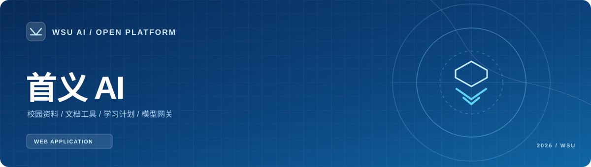
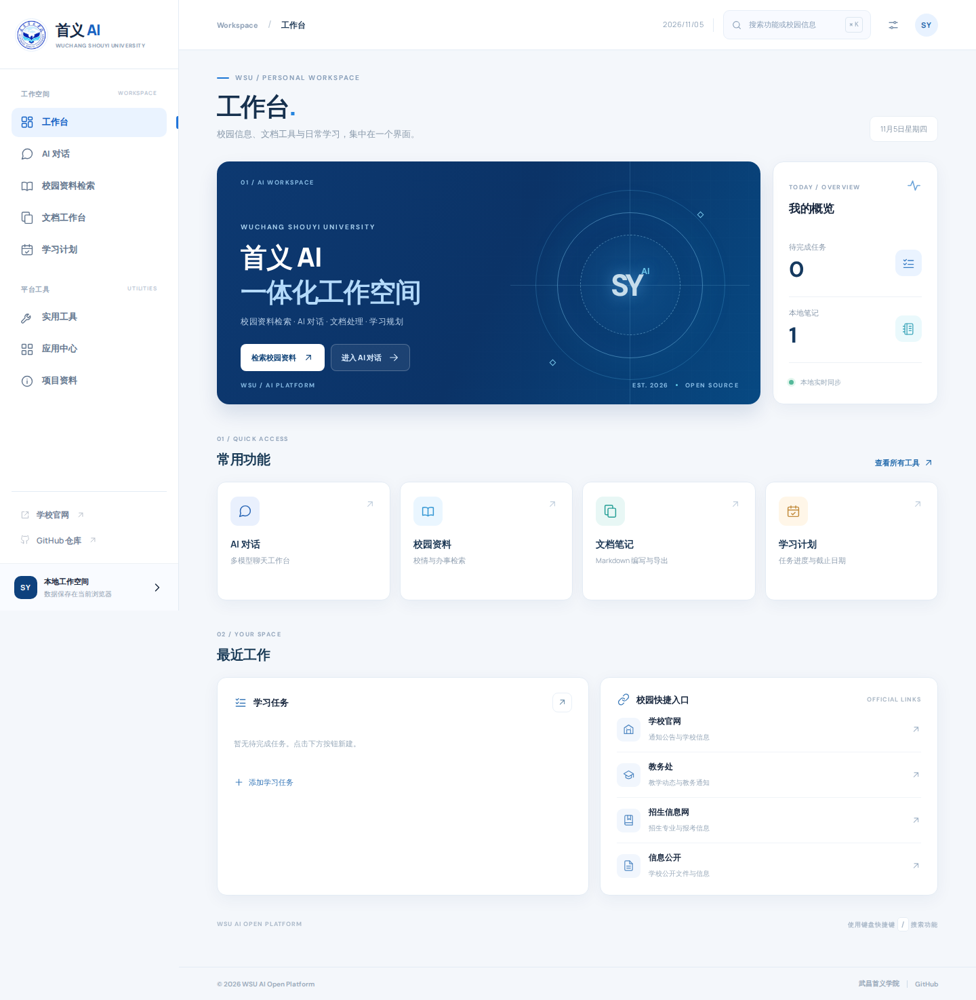
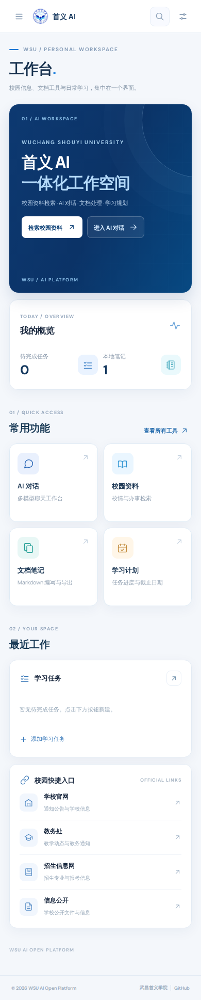
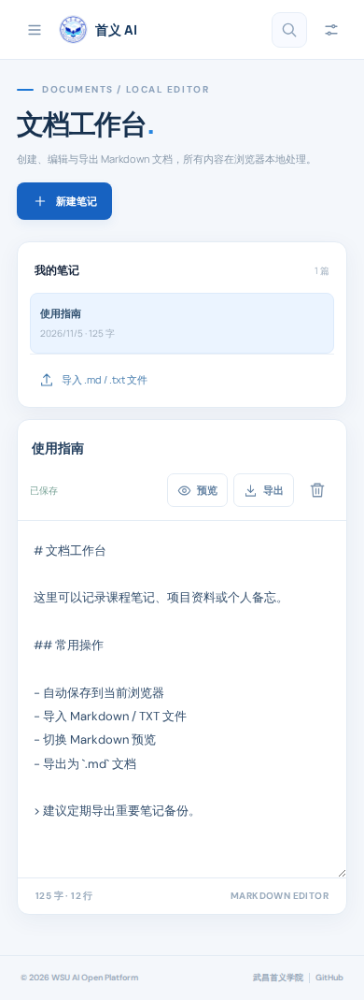
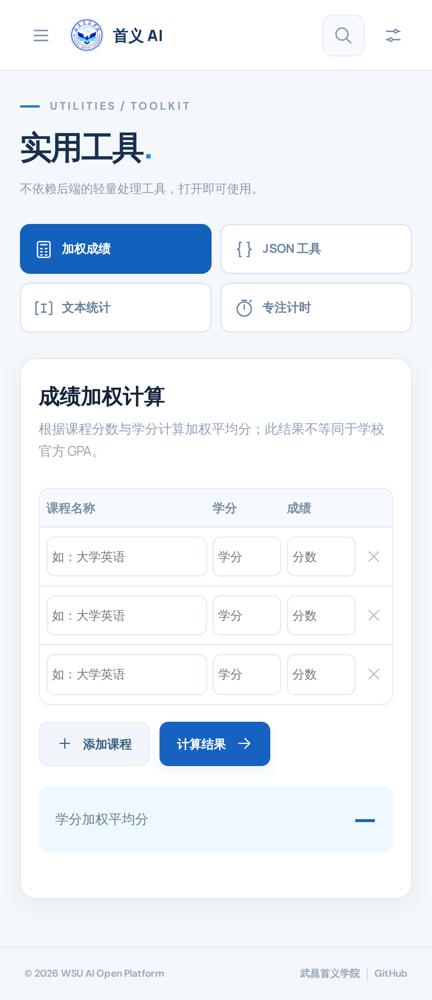

<div align="center">
  <a href="https://cha290196-hue.github.io/WSU-AI-Open-Platform/">
    
  </a>
  <p>
    <a href="https://cha290196-hue.github.io/WSU-AI-Open-Platform/"><b>访问网站</b></a>
    &nbsp;·&nbsp;
    <a href="#功能"><b>功能</b></a>
    &nbsp;·&nbsp;
    <a href="#技术实现"><b>技术实现</b></a>
    &nbsp;·&nbsp;
    <a href="#开发与运行"><b>本地运行</b></a>
    &nbsp;·&nbsp;
    <a href="https://github.com/cha290196-hue/WSU-AI-Open-Platform/issues"><b>Issues</b></a>
  </p>
  
  
  
  
</div>

<br>

## 项目

**首义 AI** 是围绕武昌首义学院学习场景开发的 Web 工作台，集成校园公开资料检索、Markdown 笔记、任务计划、成绩计算与文本处理。AI 对话可使用 Puter 免费额度，也可连接个人部署的 OpenAI-compatible API 网关。

- **访问地址**　https://cha290196-hue.github.io/WSU-AI-Open-Platform/
- **部署方式**　静态页面通过 GitHub Actions 发布至 GitHub Pages
- **数据存储**　笔记、任务、会话记录保存在使用者当前浏览器
- **项目依赖**　前端原生 HTML / CSS / JavaScript，无需安装 Node.js
- **免费问答**　Puter.js 浏览器 SDK；每位用户使用自己 Puter 账号的免费月度额度

## 界面

[**打开实时界面**](https://cha290196-hue.github.io/WSU-AI-Open-Platform/) 查看桌面与手机适配。交互覆盖侧栏导航、全局命令搜索、工具切换与各工作区。

<!-- SCREENSHOTS_START -->
<table>
<tr><td width="72%" align="center"><b>Desktop · 1440 px</b></td><td width="28%" align="center"><b>Mobile · 390 px</b></td></tr>
<tr>
<td valign="top"></td>
<td valign="top"></td>
</tr>
</table>

<details>
<summary><b>查看文档与工具页面</b></summary>

| 文档工作台 | 实用工具 |
|:---:|:---:|
|  |  |

</details>

[完整视觉测试报告](assets/screenshots/visual-report.json) · [更多桌面截图](assets/screenshots/)

<!-- SCREENSHOTS_END -->

## 功能

<table>
  <tr><th width="28%">工作区</th><th>主要操作</th><th width="16%">运行位置</th></tr>
  <tr><td><b>Dashboard</b><br>工作台</td><td>任务概览、最近工作、校园常用入口</td><td>浏览器</td></tr>
  <tr><td><b>Knowledge</b><br>校园资料</td><td>关键词检索、分类筛选、来源跳转与复制</td><td>浏览器</td></tr>
  <tr><td><b>Documents</b><br>文档工作台</td><td>Markdown 编辑、预览、自动保存、导入与导出</td><td>浏览器</td></tr>
  <tr><td><b>Planner</b><br>学习计划</td><td>任务创建、截止日期、状态筛选、完成进度</td><td>浏览器</td></tr>
  <tr><td><b>Utilities</b><br>实用工具</td><td>成绩加权计算、JSON 格式化、文本统计、专注计时</td><td>浏览器</td></tr>
  <tr><td><b>AI Chat</b><br>免费问答</td><td>Puter.js 直接请求模型；首次使用按提示登录，按账户额度计量</td><td>浏览器 / Puter</td></tr>
  <tr><td><b>Model Gateway</b><br>自定义 API</td><td>独立会话、网关地址、模型名称、访问令牌配置</td><td>独立网关</td></tr>
</table>

### 操作方式

| 操作 | 快捷键 / 入口 |
| --- | --- |
| 打开全局命令菜单 | `Ctrl / ⌘ + K` |
| 搜索页面或功能 | `/` |
| 关闭浮层 | `Esc` |
| 聊天发送 / 换行 | `Enter` / `Shift + Enter` |
| 导入笔记 | 文档工作台 → 导入 `.md` 或 `.txt` |
| 导出笔记 | 文档工作台 → 导出 Markdown |

## AI 对话

默认打开 **免费通道（Puter）**。无需填写 API Key：打开「AI 对话」，发送问题，首次使用时按提示完成 Puter 账号授权。页面通过 [Puter.js](https://docs.puter.com/AI/chat/) 直接调用模型，并将对话历史保存在本地浏览器。

Puter 为每个账户提供**有限的免费月度额度**，不是无限免费。额度、可用模型与后续付费选项由 [Puter](https://docs.puter.com/user-pays-model/) 管理，使用前可在其账户中查看用量。

选择 **自定义 API** 后，可以在「API 设置」填写独立部署的服务端网关地址、模型 ID 和访问令牌。两种通道的历史记录相互隔离；切换不会覆盖另一通道的会话。服务商密钥保存在你自己的网关服务端，不写入本仓库。

如果免费 SDK 因网络环境无法加载，可切换到自定义 API；也可使用 [Duck.ai](https://duck.ai/) 的官方网页作为独立的免费 AI 入口（不嵌入本站）。

## 技术实现

```text
                   ┌────────────────────┐
                   │    GitHub Pages    │
                   │ Web UI · Local data│
                   └─────────┬──────────┘
                             │
                ┌────────────┴─────────────┐
                │                          │
      ┌─────────▼─────────┐     ┌──────────▼──────────┐
      │     Puter.js      │     │    API Gateway      │
      │ Browser AI SDK    │     │  Cloudflare Worker  │
      │ Puter user quota  │     │  Own server secrets │
      └─────────┬─────────┘     └──────────┬──────────┘
                │                          │
           Puter AI                  Model provider
```

前端代码位于 [`index.html`](index.html) 和 [`assets/`](assets/)。校园公开资料与图标定义位于 [`assets/data.js`](assets/data.js)，交互逻辑位于 [`assets/app.js`](assets/app.js)。页面样式拆分为基础规则 `styles.css` 和布局修订 `polish.css`。

免费对话由 Puter.js SDK 执行，不需要本地 API Key。AI 网关示例位于 [`server/worker.js`](server/worker.js)，使用 Cloudflare Workers 环境变量保存上游密钥。具体部署参数见 [`server/README.md`](server/README.md)。

## 开发与运行

```bash
git clone https://github.com/cha290196-hue/WSU-AI-Open-Platform.git
cd WSU-AI-Open-Platform
python -m http.server 8000
```

打开 `http://localhost:8000`。前端不需要编译。向 `main` 推送提交后，GitHub Actions 自动构建静态产物并发布。

### 项目目录

```text
WSU-AI-Open-Platform/
├── index.html                  页面结构
├── assets/
│   ├── styles.css              基础设计系统
│   ├── polish.css              组件与响应式修订
│   ├── app.js                  路由与交互逻辑
│   ├── data.js                 校园资料与图标
│   ├── school-emblem.png       武昌首义学院校徽
│   ├── readme-cover.svg        仓库封面
│   └── favicon.svg             网站图标
├── server/
│   ├── worker.js               AI 网关示例
│   └── wrangler.toml.example   部署配置
├── scripts/                    校徽来源处理脚本
└── .github/workflows/          构建、部署与视觉测试
```

## 设计

| 层级 | 配色 | 用途 |
| --- | --- | --- |
| Navy | `#0C2E5C` | 导航文字、主视觉 |
| Blue | `#1762C1` | 按钮、焦点、状态 |
| Cyan | `#52C6ED` | 次级强调 |
| Canvas | `#F4F7FB` | 页面背景 |
| Surface | `#FFFFFF` | 工作区、卡片 |

校徽采用武昌首义学院公开标识，设计参考[学校章程](https://www.wsyu.edu.cn/_upload/article/files/e4/f6/95830c01431aa36195abe1f98229/b5190731-2226-4cc4-a527-30035884e023.pdf#page=2)。校徽及学校名称的相关权利仍归原权利主体所有。

## 参与开发

问题反馈与功能需求通过 [GitHub Issues](https://github.com/cha290196-hue/WSU-AI-Open-Platform/issues) 跟踪。修改代码可以提交 Pull Request。源码按 [MIT License](LICENSE) 发布。

---

<div align="center"><sub>WSU AI OPEN PLATFORM · 2026</sub></div>